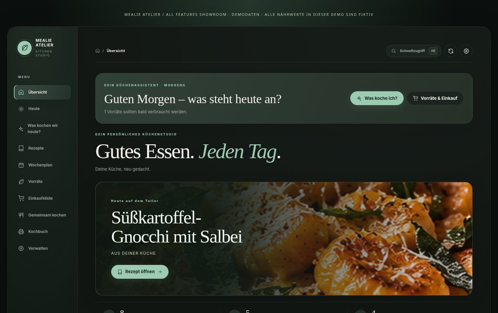
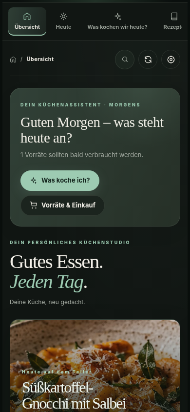

# Mealie Atelier

**A warmer, more useful kitchen companion for Mealie.** Home Assistant cards, an optional standalone Web app, and a bilingual demo live together here; the Bridge integration has its own repository.


## Home Assistant Cards

An elegant, visual Home Assistant kitchen studio for Mealie: recipes, meal planning, groceries, and a clean step-by-step cooking mode — all with a native UI editor, dark/light mode and colors.





> Screenshots use fictional sample recipes, not a real Mealie account. Real recipe photos are loaded from Mealie via the Atelier Bridge.

## Install

For the easiest Home Assistant path, follow the [guided setup](docs/INSTALLATION_0.9.5.md). It starts with a choice: use Home Assistant's built-in Mealie integration for read-only recipe discovery, or add the optional Atelier Bridge for the complete studio.

When published, install **Mealie Atelier Cards** from Home Assistant Marketplace or HACS under **Dashboard**. The UI-managed setup registers the JavaScript module resource for you; reload the browser when prompted. Then open **Edit dashboard → Add card**, search **Mealie Atelier**, and choose **Complete Kitchen** or a focused card. The visual editor detects an existing Mealie connection and walks through the opening view and appearance. No card YAML is needed.

This developer-preview archive is not published in the catalog yet. For temporary testing, copy `dist/mealie-atelier-cards.js` to `<config>/www/mealie-atelier-cards.js`, register `/local/mealie-atelier-cards.js` as a JavaScript **module** in **Settings → Dashboards → ⋮ → Resources**, and refresh the browser. YAML-managed Lovelace resources require the advanced manual path in the [setup guide](docs/INSTALLATION_0.9.5.md).

## Ten card types

| Dashboard card type | Purpose |
|---|---|
| `custom:mealie-atelier-card` | Full kitchen overview with navigation and every feature |
| `custom:mealie-atelier-today` | Today overview: meals and outstanding groceries on one screen |
| `custom:mealie-atelier-recipes` | Recipe catalog, search, details and cooking mode |
| `custom:mealie-atelier-mealplan` | Weekly planner + add/delete meals |
| `custom:mealie-atelier-shopping` | Interactive Mealie shopping list + item check/add |
| `custom:mealie-atelier-manage` | Create/import recipes and edit name, description, servings, steps and ingredient text |
| `custom:mealie-atelier-discover` | Personal recommendations and proposed seven-day menu |
| `custom:mealie-atelier-pantry` | Pantry-light and grocery calculations |
| `custom:mealie-atelier-family` | Shared cooking sessions and adult-approved helper tasks |
| `custom:mealie-atelier-cookbook` | Print-ready A4 recipe collection |

```yaml
type: custom:mealie-atelier-card
mode: dashboard
language: de
theme: dark
accent: '#9dcbb2'
columns: 3
show_images: true
```

This release uses a single `dist/mealie-atelier-cards.js` file, with no external JavaScript dependencies. The card supports German and English, automatic Home Assistant/browser language detection, and an explicit choice in both the card editor and **Design Studio**. Locale resources live in `src/i18n/`; the build discovers language files automatically, and tests enforce complete translation-key parity and coverage of Atelier-owned translation calls. The emulated visual matrices and limitations are recorded in the QA evidence and release-readiness checklist; they do not replace physical-device or live Home Assistant acceptance. Built-in graphical card settings also include mode, Mealie account, provider, appearance, density, columns, accent, rounded corners and recipe image visibility. Provider `auto` prefers Atelier and uses the official Home Assistant Mealie integration as a read-only fallback when the Bridge is unavailable. The Core provider supports recipe search, recipe details and cooking steps; photos and writes need Atelier Bridge. Some look settings are saved per browser. For publicly shared dashboards, enable only trusted users — write actions are possible in meal plans and shopping lists.

## Preview

Build the standalone preview with `npm run build:demo`, serve the generated `demo/public-site/` directory, and open its `/de/` or `/en/` route. The checked-in `demo/preview.html` is the generator template and should not be opened directly. The interactive demo uses fictional data and keeps all changes in the current browser tab; it never contacts Mealie or Home Assistant. Ten bilingual, fully stepped recipe fixtures live in `demo/data/recipes.json` and use credited Unsplash photography.

Generate the publishable bilingual showcase with `npm run build:demo`. This creates the interactive site, static DE/EN recipe pages and structured metadata in `demo/public-site/`. To emit canonical links, `robots.txt` sitemap reference, and `sitemap.xml`, provide the final public base URL, including its deployment subpath when applicable:

```sh
ATELIER_DEMO_BASE_URL=https://example.com/mealie-atelier/ npm run build:demo
```

The generated folder can be served as a static site; no API, account, backend, or environment secret is needed. Supply the real deployment URL only in the publish job so canonical metadata never points at an example host. Recipe and image source credits remain visible on every localized recipe page.

## Limitations

- Full features require Mealie Atelier Bridge. The official Home Assistant Mealie integration provides a limited, read-only recipe and cooking fallback (up to 500 returned matches; no recipe photos, shopping/planning writes, cookbook, nutrition workflow or server-managed kitchen alarms).
- Current meal picker lists recipes on loaded page; searchable picker is planned.
- The editor supports servings and plain-text steps. Replacing ingredient text is **disabled by default** and requires a Mealie backup plus an experimental setting in Bridge → Configure. Existing linked/quantified ingredients are protected by the backend. This still needs real Mealie acceptance tests. Image upload is not yet supported.
- A safe read-only mode can be enabled under the Bridge integration options. All write buttons then disappear; the server enforces this restriction.
- The repository is still a developer preview. Real HA/Mealie smoke tests and Marketplace registration remain release gates; see the [release checklist](docs/RELEASE_READINESS_0.9.5.md).

**License:** MIT. Unofficial companion.

## Print Studio (v0.3)

Open a recipe and click **Print / PDF**, or print directly from your shopping list or planner. The in-card editor offers Editorial, Compact and Ink saver, photo, checkboxes and notes. Printed A4 documents exclude all dashboard navigation. This is client-side, using already authorized Mealie data; no additional server endpoint or secrets are required.

## Nutrition Lab & cooking tools (v0.5)

Open a recipe and click **Nährwerte** (Nutrition) to review USDA food matches, confirm grams and calculate source-backed per-serving totals. Optionally enable AI ingredient-name suggestions on the backend. Nutrition saves ask for explicit confirmation, require valid matches for every ingredient, and cannot run in read-only mode. Stored nutrition can be added to recipe printouts using the new **Print nutrition** checkbox; it is off by default.

The cooking mode offers per-recipe notes and ratings plus kitchen timers. In the Atelier Bridge and standalone providers, shared-session timers are stored server-side and can notify after the browser closes; delivery depends on the configured Home Assistant notification service or standalone Web Push subscription. Core-provider timers are local to the current browser session. Personal notes and ratings remain scoped to the current user/provider. Demo nutrient numbers are artificial.

## Kitchen Intelligence cards (v0.6)

Discover, Pantry, Family and Cookbook were added to the standard six cards. Each works as a dedicated Lovelace card or as a view in the full kitchen dashboard. The native graphic editor supports kiosk-style presentation as well as optional kitchen HA scene, volume and TTS entity IDs, executed **only when clicked**.

The offline demo contains artificial recipe and pantry fixtures. The persistent state lives in the companion server or HA Bridge; it is no longer limited to browser localStorage. In Home Assistant, journals are scoped to the logged-in HA user. Keep your Home Assistant permissions restrictive; the simplified child view is not a security boundary.

The current recommendation engine is a deterministic heuristic, not a culinary/allergen diagnosis. Pantry/staple quantities are user-provided, not detected automatically. Weekly planning and shopping writes need a supported Mealie API and explicit user confirmation. The cookbook print path was browser-tested with eight demo recipes over ten A4 pages; real printer and iPhone/Safari tests remain.

## Support

Mealie Atelier is an independent community project. If it makes your kitchen easier, you can optionally [say thanks on Ko-fi](https://ko-fi.com/allesautomatisch). The card offers the same voluntary link in Design Studio; it never interrupts cooking or gates features.


## Standalone Web app, demo, and documentation

- The independent [Web app](web/README.md) runs without Home Assistant and keeps the Mealie token on its server. Its Docker image and tests are released independently from HACS card packages; all build, test, and publication steps are manual.
- The [bilingual live-demo source](docs/DELIVERY_CHECKLIST_2026-10-28.md) builds from ten fictional recipes. Visitor changes remain in the browser and never reach Mealie or Home Assistant. It has not been deployed to a public URL yet.
- German and English documentation sources live in [`docs/site/de/`](docs/site/de/) and [`docs/site/en/`](docs/site/en/); the hosting route still needs final confirmation.
- Repository layout and publication boundaries: [`docs/REPOSITORY_MAP.md`](docs/REPOSITORY_MAP.md).

## Development

From this repository root, run `npm run build && npm test && npm run check`. Run the standalone Web tests with `cd web && node --test test/*.test.mjs`. The Bridge package has its own tests and release boundary in [its repository](https://github.com/mealie-atelier/mealie-atelier-bridge). Run and review each package’s checks manually before publishing.

## Made with love

Made with love by Daniel Boberg · [alles-automatisch.de](https://alles-automatisch.de/).
