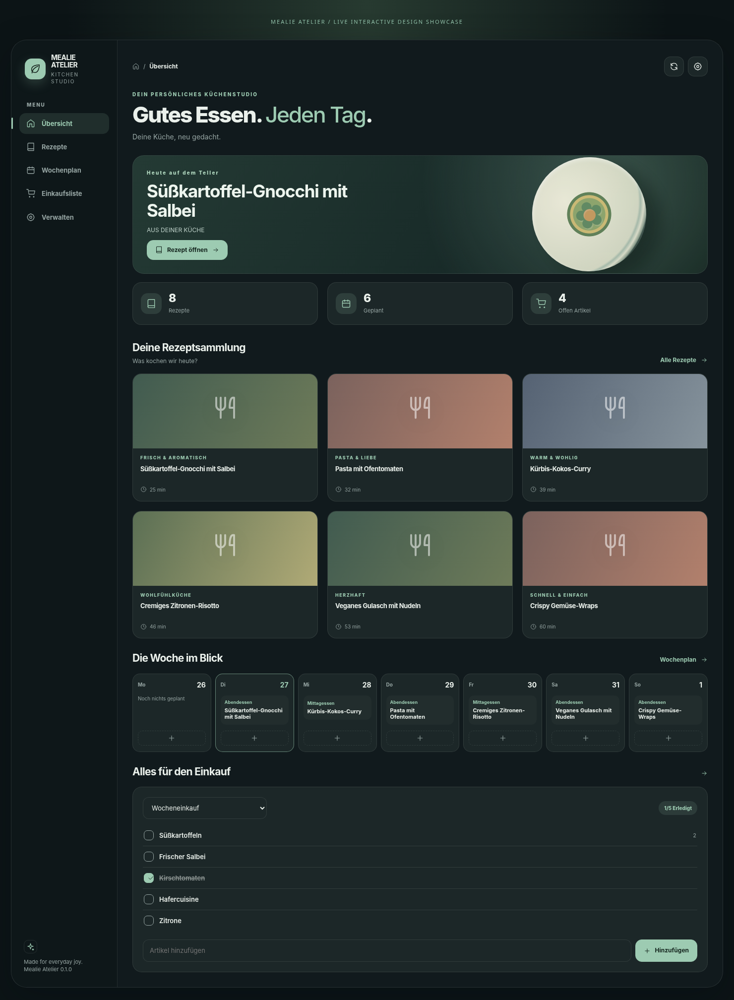

# Mealie Atelier Web · private standalone recipe dashboard

Run the full Mealie Atelier kitchen UI on iPhone, tablet or a wall display **without Home Assistant**. This standalone companion shares the same visual components as the HACS cards, but uses a local, password-protected Node proxy to your own Mealie API.



## Docker quick start

```bash
cp .env.example .env
# Edit MEALIE_URL, MEALIE_API_TOKEN and a long ATELIER_PASSWORD in .env
docker compose up -d --build
```

Optional **read-only** kiosk mode: add `ATELIER_READ_ONLY=true` to `.env` and restart. The server will reject all mutation commands, not just hide buttons.

Experimental ingredient replacement is disabled by default. Only with a Mealie backup and explicit `ATELIER_EXPERIMENTAL_INGREDIENTS=true` can you enable it; existing food/unit/quantity associations are still protected.

The included `compose.yaml` binds the application to `127.0.0.1:3008` on the host and should not be published on public interfaces. Open `http://127.0.0.1:3008` from the Docker host. To use from a different device, put a HTTPS reverse proxy with modern authentication in front, or use a trusted private network (e.g. Tailscale). **Do not expose the container directly to the Internet. Basic auth over HTTP is insecure on untrusted networks.**

## Node quick start

```bash
# Node.js 22 or later
cp .env.example .env
# Load MEALIE_URL, MEALIE_API_TOKEN, ATELIER_USERNAME, ATELIER_PASSWORD, PORT into env
node server.mjs
```

The server will refuse to start without the required environment variables. `.env` itself is read by Docker Compose; for direct Node use you must source or otherwise export it.

## Tests

```bash
node --test test/*.test.mjs
```

These tests boot a mock Mealie API and test authorization, recipe listing and editing, shopping writes, read-only enforcement, image proxy and path hardening. They are not full compatibility tests against a real Mealie installation.

The opt-in live read-only smoke check in `test/live-readonly-smoke.mjs` requires `MEALIE_ATELIER_TEST_READONLY=1`, `MEALIE_URL` and `MEALIE_API_TOKEN`. Run it only against a dedicated test instance with a read-only token; do not include secrets in logs or archives.

## Notes

- No npm packages; just Node 22 built-in server and fetch.
- User credentials and Mealie tokens remain on the server. Never bake `.env` into your Docker image or expose it in Git.
- Use the **Install app** control at the bottom of the page for platform-specific instructions. Chromium can open its native install prompt; on iPhone/iPad, open the site in Safari and use **Share → Add to Home Screen → Open as Web App → Add**. The app includes dedicated Chromium and Apple home-screen icons. Serve it from a trusted HTTPS origin (or localhost for development). The service worker does not cache private API data or recipe photos.
- This is not a HACS-installable integration. The bridge and cards are separate optional HA packages.
- Currently supports one Mealie token/household per web server; all web logins share its permissions.

**License:** MIT. Unofficial Mealie companion.

## Printing recipes and plans (v0.3)

Recipe detail, shopping lists and planner now open the same **Print Studio** as the Home Assistant cards. The print document is generated in the browser; you can print or choose Save as PDF. No Mealie token is embedded into the print document. Images, if explicitly enabled, use the server-side authenticated image proxy.

## Nutrition Lab (v0.5 beta)

Put `USDA_FDC_API_KEY=...` in your private `.env` to enable USDA food matching and per-serving nutrition calculations. To **optionally** use AI to suggest USDA English search terms, provide your own `OPENAI_API_KEY=...`. Both keys remain on the web backend. **Only an explicit click** sends ingredient text to OpenAI; nutritional values are not taken from the language model.

Opening the Nutrition Lab fetches recipe data, then lets you confirm each USDA match and actual gram weight. Save to Mealie requires a fresh recipe hash, server-side recalculation, and explicit replacement consent for any existing nutrition. `ATELIER_READ_ONLY=true` rejects writes on the server. Recipes and nutrient values differ in Mealie releases: please test with a backed-up test instance first. The browser-only Cooking Cockpit timers/journal are not multi-device-synced.

**Privacy:** USDA lookup sends your ingredient search query to USDA; AI name suggestions send ingredient text to OpenAI on demand. The app does not store AI input in an application database; the provider's privacy rules still apply. Do not post public API keys in issues or screenshots.

## Kitchen Intelligence: persisted state (v0.6)

`ATELIER_DATA_DIR=/app/data` is the persistent JSON store for profile, pantry, cooking journal, family members and cooking sessions. The Docker Compose configuration includes a named volume `atelier_data`, which survives container recreation. Protect this volume and back it up together with Mealie. Atomic writes and monotonic revision numbers prevent stale clients from silently overwriting newer state.

A standalone server has **one shared user account**; it does not distinguish family members through logins. If you need per-user recipe journals, use Home Assistant with individual accounts. The child helper view is not an authorization barrier. There is no off-device push notification guarantee for countdown timers. AI quality checks and ingredient substitutes are opt-in and require your private `OPENAI_API_KEY`.

Run the automated tests with `node --test test/*.test.mjs`. They cover private-state persistence, server restart, stale-revision rejection, read-only, protected Mealie proxy endpoints and ingredient checks using fake services. USDA/OpenAI live calls remain unverified.

## Support

If Mealie Atelier helps your kitchen, you can optionally [say thanks on Ko-fi](https://ko-fi.com/allesautomatisch). It is voluntary and never gates a feature.
